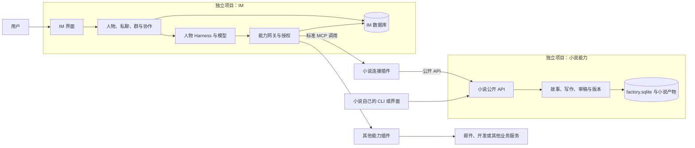

# 通用人物 IM 与独立能力项目的组合架构

日期：2026-10-20。状态：独立 IM 副本已创建；能力服务组合、迁移与整版验收仍待完成。

本决定优先于 `docs/im` 和历史方案中“聊天与小说共用 factory.sqlite”“在小说仓库建设整个 IM”的安排。现有小说生产入口继续按当前代码运行；本次没有迁移数据库。

产品定位与开发顺序以[版本化产品 PRD](../product/README.md)为准：平台面向任意符合契约的能力，小说只是下文的接入实例。平台先完成独立 IM 和非小说能力验证，不以小说接口开发为前置条件。首版运行底座按[整体选型](harness-decision.md)复用 Pi SDK，并收紧权限、恢复和并发等宿主默认行为。

## 1. 项目边界

一个独立 IM 项目组合任意多个独立能力项目，每项能力通过可独立发布的连接插件接入。IM 安装并授权能力，能力服务处理领域数据，连接插件只做协议转换。以下以现有小说项目说明具体边界，同样适用于检索、数据分析、开发等能力。

| 项目/产物 | 拥有的功能与数据 | 独立运行要求 |
| --- | --- | --- |
| IM 主体 | 人物、人格、模型、联系人、私聊、群、成员关系、个人记忆、会话 Session、协作工作、运行预算、能力授权 | 没有任何业务插件也能创建人物、单聊、建群和讨论 |
| 任意能力服务 | 本领域的数据、规则、资源权限、operation 与成果 | 有自己的公开客户端/接口，不依赖 IM 人物或群 |
| 小说能力服务 | 小说项目、设定、人物设定、章纲、草稿、审稿、版本、Canon、小说知识与领域工作 | 不启动 IM，也能通过自己的 API/CLI 操作小说 |
| 小说连接插件 | MCP 工具映射、Agent Skills、结果转换、公开接口兼容 | 可安装/停用/升级；不包含小说引擎或 IM 的内部实现 |

“人物”有两个不同概念：IM 的作者是长期 AI 同事；小说的人物是书内角色。两个项目不共享 Person/Actor 类型。

## 2. 架构图



图中是目标关系。网关、小说 MCP 插件和新的细粒度 API 尚待开发。插件与小说服务是独立进程；第一版本地组合即可，不要求先建设微服务集群。

## 3. 代码与仓库归属

按用户明确授权，从内部参考项目复制代码到当前工作区的独立项目 `projects/persona-im`，继续复用 Pi SDK。原参考项目与其插件工程都仅作只读参考，不再作为构建、运行或同步回写的目标。现有小说工程继续负责小说领域。

IM 副本有自己的 Git、package/lock、构建、测试和数据命名空间，不参加小说根包的构建链，也不写入小说 Git 历史。放在同一工作区是目录安排，不是运行耦合；可单独搬走或发布。许可证和来源声明随副本保留。

目标布局：

```text
projects/persona-im/               IM 独立副本，自己的 Git、构建、测试、发布
  packages/core/                   人物、聊天、协作、运行与能力网关
  packages/server/                 IM API
  src/im/                          IM 界面

ai-novel-factory/                  小说项目，自己的构建、测试、发布
  packages/ai-novel-core/          小说业务引擎
  packages/ai-novel-server/        小说公开 API
  apps/desktop/                   小说自己的管理界面，可选使用

capability-connectors/novel/       独立连接插件目标目录，尚未创建
  .claude-plugin/plugin.json       安装与配置说明
  .mcp.json                       标准 MCP 服务配置
  skills/                         写作、规划、审稿技能指南
  src/                            MCP 到小说公开 API 的转换
```

插件也可以单独建仓发布；以上路径不构成运行要求。IM 不要求小说仓库位于相邻目录，插件不通过 `../../ai-novel-core/src` 引入源码。默认插件市场引用已发布版本；本地开发可以单独配置服务地址。

不建立两个项目必须同步升级的共享运行时包。协议用版本化 JSON Schema、公开 API 和兼容性样例表达；TypeScript 类型可由契约生成，不能夹带数据库连接、引擎或 UI。

## 4. 依赖与事实归属

1. IM 可以依赖 MCP/Skills 等通用标准；IM 核心不引用小说包，也不根据 `novel` 写业务分支。
2. 小说核心不引用 IM、PM Bridge、Pi 或 OpenCode；现有 OpenCode 插件是小说的外围适配器，不能成为领域前置依赖。
3. 连接插件只依赖通用 MCP SDK 和小说公开 API；宿主专用展示信息放可选扩展中。
4. IM 的数据库保存聊天与授权事实；小说的 factory.sqlite 保存小说事实；两边禁止跨库 SQL、共享连接和跨库事务。
5. IM 只缓存资源名称、版本和状态等投影。正式正文、评审是否有效、是否通过发布门禁，以小说服务的版本化结果为准。
6. 能力服务可以记录不可解释的外部调用者标识用于审计，但不管理群成员、人物人格或聊天权限。
7. 领域事件不能直接变成任意群消息；由 IM 依据绑定、接收范围和当前权限生成交付卡片。

两个数据库分别是自己领域的唯一事实来源，不是两套小说状态。备份各自独立；组合映射丢失可以重新绑定，不得从聊天摘要覆盖小说正式版本。

## 5. 人物、能力、工作与资源

| 对象 | 所属 | 示例 |
| --- | --- | --- |
| 人物 | IM | 同一个长期存在的作者 |
| 能力定义与技能 | 能力提供方/连接插件 | 章纲规划、正文提交、审稿 |
| 长期能力授权 | IM | 作者长期具备写作工具使用资格 |
| 工作绑定 | IM | 作者在本次创作中使用指定工具、账号与资料 |
| 业务资源 | 小说服务 | 小说 A、第 3 章、草稿版本 v4 |
| 业务资源权限 | 小说服务 | 本次访问可读小说 A、可提交第 3 章候选稿 |

人物模板是可编辑配置，不在核心写死“编剧/作者/编辑”。技能指南描述怎么做；工具授权决定可执行动作；知识授权决定可读取和向谁披露。三者分别保存。

同一人物可以在群 A 写小说 A，在群 B 写小说 B。工具集、资料、调用身份和原生 Session 按工作隔离。人物存在不依赖任何一本小说。

## 6. 用户组合流程

通用流程为安装兼容能力、给人物授权、创建私聊/群、选本次资源/知识、发需求、执行和交付。下面以小说说明一次组合；数据分析可以换成数据集和报告，资料检索可以换成文档与引用，核心流程不变。

1. 在能力库安装小说插件，连接一个小说服务实例，验证版本和账号。
2. 创建编剧、作者、编辑等人物，选择其长期能力；已有的人物可以直接复用。
3. 创建普通群、邀请人物，照常聊天。
4. 为这次创作关联已有小说，或由获准人物创建小说；选择各人的临时工具、知识与资源范围。
5. 在群里提出要求，人物讨论并各自接受工作，再通过能力工具读取资料、保存大纲、提交正文和评审。
6. 小说服务产生真实版本和操作结果，IM 把获准的成果回到原工作/群，并保留执行人和来源。

群关联的是通用“外部资源”，不是强制绑定一个小说项目。普通群没有业务资源也可使用；群可以有多个工作，每项工作分别关联资源；删除群不删除小说。

## 7. Session 与模型边界

人物 Harness 是 IM 的内部实现。副本按用户认可的评估结果复用 Pi SDK，OpenCode PoC 留作历史参考；不维护第二条未经验证的主运行路径，也不把 Harness 写进小说协议。复用代码不等于允许修改原参考项目。

默认路径由人物模型创作，小说工具负责读取约束、保存内容、检查和版本提升，避免“作者”调用一个工具后又悄悄启动另一套作者/编辑角色。少量确定性检查由领域服务直接执行。

原有长流水线可作为显式选择的 `legacy_batch` 自动化能力保留。需要模型生成的领域批处理由小说服务使用自己的 Provider 配置和费用额度；IM 的模型密钥、Pi Agent、OpenCode Session 均不跨协议传递。批处理的执行者明确标为服务自动化，不冒充群里的多个人物。

## 8. 运行与组合模式

| 模式 | 启动内容 | 可用行为 |
| --- | --- | --- |
| IM 单独运行 | IM 服务与界面 | 人物、私聊、群、普通讨论 |
| 小说单独运行 | 小说 API/worker，可选自己的界面 | 原有小说生产与 API/CLI |
| 本地组合 | 两个服务，加一个由宿主启动的 MCP 插件进程 | 群协作调用小说能力 |
| 远程能力 | IM 本地，小说 API 远程，插件持有受限连接 | 同一契约，认证和连接方式改变 |

一键启动脚本只负责进程编排与健康检查，不合并数据库或打包彼此源码。组合配置属于部署者，包含服务地址、版本、凭据引用，不包含原始密钥。停用小说插件后聊天历史仍可读；小说界面可以继续操作其项目。

## 9. 接口、迁移与验收

- [版本化产品 PRD](../product/README.md)：通用平台范围、各版计划和工程/用户验收，优先于历史实施顺序。
- [能力契约](capability-contract.md)：发现、调用、授权、知识、异步结果、取消和版本兼容。
- [小说接入与迁移](novel-integration.md)：现有引擎的具体拆接、旧代码处理、分批交付和解耦验收。
- [操作结果 Schema](contracts/operation-result.schema.json)：组合层统一的短调用/长工作结果契约草案，尚未部署。
- [示例数据](examples/README.md)：人物工作绑定、受理结果与完成结果，不是可以直接启动产品的配置。

最关键的验收是双向独立：IM 不安装小说插件仍能使用；小说不启动 IM 仍能使用；接入第二种业务能力时不修改 IM 核心、不修改小说核心。

## 10. 本轮交付验证

已检查本目录与 IM 文档共 10 份 Markdown 的 40 个本地链接/引用锚点，6 份 JSON 均可解析。使用本机已有 Ajv 2020 严格编译结果 Schema，3 个操作结果样例通过，8 个非法样例被拒绝，覆盖未知版本、无效状态/修订号、缺错误、成功却带错误、缺成果版本、伪造额外身份字段和未知效果自动重试。

`git diff --check` 通过。本轮只编辑架构/契约/示例及旧文档入口，没有修改运行源码或重新运行引擎测试。工作区原有 FactoryDb 增量仍存在，GitNexus 检测继续报告 high、14 条受影响流程；那属于上一批同库实现的回归范围，迁出时须重新分析，不能据本轮文档验证标为已解决。

新增独立副本的构建、运行与源码边界证据记录在副本自身的复制隔离报告。能力服务互通、插件安装、真实模型及完整 SEP-01–SEP-14 尚未验收。平台按 v0.1 PRD 补齐通用 IM；小说 S1 独立推进，不作为平台前置。
