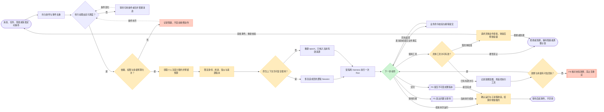
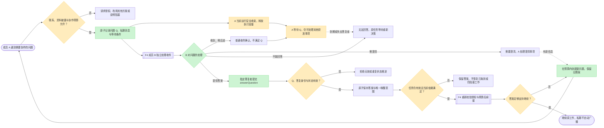
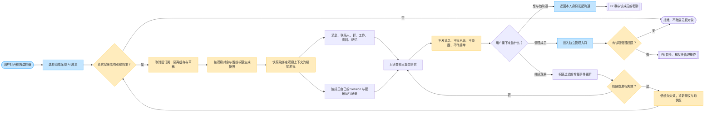

# 数字成员协作系统：完整流程图

> 状态修正：用户指出本图偏向任务流水线，不能作为 IM 产品主流程。保留作工程机制参考；最新产品主线是建群邀请、讨论要求、人物分别调用独立能力。OpenCode/Pi 的最终选型暂缓，以 V2 文档“当前确认”与详细设计第 20 节为准。

- 日期：2026-10-14；性质：目标方案，不代表功能已实现。
- [打开可缩放完整图](2026-10-14-person-world-complete-flow.html)。本文件保留全部 Mermaid 源图和各图约束说明。
- 依据：[V2 架构](2026-10-14-person-world-and-harness-v2.md)、[交互详细设计](2026-10-14-person-world-detailed-design.md)、[工程契约](2026-10-14-person-world-runtime-contracts.md)。
- 阅读：总览中的 F1–F8 对应后续同编号子流程；它们是同一套流程的展开，不是八套独立系统。
- 图例：矩形为动作，菱形为条件，双边矩形为子流程，圆角为入口/出口，虚线为旁路或异步触发。蓝色为真实用户动作，绿色为成员行为，黄色为系统校验/等待，红色为异常。
- 身份：用户操作保留真实操作者；AI 在自己的权限内行动。协调人不是超级用户，观察者不能冒用成员发言。
- 接单策略尚待用户选择：建议明确请求在既有预授权内直接接单；图中同时保留逐次确认模式。

## 0. 总览

```mermaid
flowchart LR
    workspace(["用户进入工作空间"])
    directory["我的消息与团队名录"]
    createPerson[["F1 创建与启用独立成员"]]
    person["稳定身份与个人空间"]
    entry{"本次入口"}
    dm[["F2 私聊与工作交办"]]
    group[["F3 建群与协作约定"]]
    ordinary["普通交流或保持安静"]
    commitment["成员接受明确工作条款"]
    personalQueue["个人承诺台账与工作队列"]
    runtime[["F4 私有 Session 与受控执行"]]
    help[["F5 同事求助与等待恢复"]]
    change[["F3 重要变更审批与应用"]]
    delivery[["F6 版本交付与验收"]]
    revise["按反馈生成新版本"]
    done["成果完成与真实经历"]
    memory["有来源的经验候选与确认"]
    persist["项目可归档，人物继续存在"]
    observe[["F7 切换人物视角，只读观察"]]
    safe[["F8 暂停、撤权、异常核对与恢复"]]
    workspace --> directory
    directory -->|"新增成员"| createPerson --> person
    directory -->|"已有成员"| person
    person --> entry
    entry -->|"单独沟通"| dm
    entry -->|"多人沟通"| group
    dm -->|"普通问题"| ordinary
    group -->|"无工作请求"| ordinary
    dm -->|"接受工作"| commitment
    group -->|"各自接受"| commitment
    commitment --> personalQueue --> runtime
    runtime -->|"需要同事"| help
    help -->|"依赖满足并重新校验"| runtime
    runtime -->|"改变承诺或正式设定"| change
    change -->|"必要确认且应用成功"| personalQueue
    runtime -->|"提交成果"| delivery
    delivery -->|"要求修改"| revise --> personalQueue
    delivery -->|"验收及必要写回成功"| done
    done --> persist
    done -.->|"可选且有预算"| memory --> persist
    persist -.->|"下次协作"| entry
    directory -.->|"独立观察入口"| observe
    runtime -.->|"全程安全分支"| safe
    safe -->|"满足恢复条件"| personalQueue
    classDef human fill:#C2E5FF,stroke:#3DADFF
    classDef member fill:#CDF4D3,stroke:#66D575
    classDef guard fill:#FFECBD,stroke:#FFC943
    class workspace,directory human
    class person,commitment,ordinary,revise,done,memory,persist member
    class personalQueue,safe guard
```

F1 并非每次聊天都重建人物。F7 是独立观察入口，不串入成员业务执行；F8 可在任何运行阶段介入。F4 同样承载普通答疑、邀请处理与有限的计划事件，不只有正式任务才会使用模型。

## F1. 成员创建、启用与长期存在

```mermaid
flowchart LR
    begin(["新增成员"])
    profile["姓名、专长、人格与工作偏好"]
    grants["配置资料、工具、联系范围与预算"]
    confirm["用户确认建档摘要"]
    valid{"字段与权限有效？"}
    correct["原位纠正，保留草稿"]
    persist["幂等事务创建稳定 Actor ID"]
    personal["个人空间、人格版本与授权引用"]
    paused["默认暂停，经历与记忆为空"]
    inbox["私聊可投递，暂不运行"]
    enable["所有者请求启用"]
    ready{"底座、隔离、权限、预算就绪？"}
    fix["显示缺项，保持暂停"]
    active["启用并处理持久收件"]
    worlds["自己的联系人、私聊、群与工作"]
    changes["人格、模型、技能分别版本化"]
    checks["收束当前执行，完成升级校验"]
    continuation["保留身份、承诺与真实历史"]
    archive["归档项目或群"]
    retained(["人物与获准保留的经历仍在"])
    begin --> profile --> grants --> confirm --> valid
    valid -->|"否"| correct --> profile
    valid -->|"是"| persist --> personal --> paused
    paused --> inbox
    paused --> enable --> ready
    ready -->|"否"| fix --> enable
    ready -->|"是"| active --> worlds
    inbox -.->|"启用后处理"| active
    worlds -->|"管理更新"| changes --> checks --> continuation
    worlds --> archive --> retained
    continuation --> retained
    classDef human fill:#C2E5FF,stroke:#3DADFF
    classDef member fill:#CDF4D3,stroke:#66D575
    classDef guard fill:#FFECBD,stroke:#FFC943
    class begin,profile,grants,confirm,enable,changes human
    class worlds,retained member
    class valid,paused,ready,fix,checks guard
```

建档不要求有小说项目，也不自动入群。暂停、离线和等待是不同状态；只有明确启用后才恢复调度。声明专长不等于已验证能力，安装技能也不等于获准使用全部工具。

## F2. 私聊、普通交流与工作承诺

```mermaid
flowchart LR
    begin(["人或 AI 发起获准私聊"])
    permission{"身份、联系、披露权限有效？"}
    denied(["拒绝并保留草稿或失败回执"])
    saved["事务保存消息、双方收件与 outbox"]
    available{"接收者可调度？"}
    pending["持久待处理，不假装已读"]
    invoke[["F4 接收者独立运行"]]
    kind{"内容需要什么？"}
    reply["普通答疑，或选择不回复"]
    clear{"工作范围与条款足够明确？"}
    clarify["澄清目标、成果与未确定项"]
    policy{"接单策略与已有授权？"}
    authorize["真实请求者确认条款或补授权"]
    source["核对源消息作者与条款来源"]
    choice{"接收者判断能力与负载"}
    negotiate["协商期限、范围或推荐同事"]
    decline(["拒绝请求，不产生任务"])
    accept["接收者提交接受命令"]
    task["幂等创建承诺与唯一任务"]
    queue[["F4 进入该成员个人队列"]]
    share[["F3 另建群与明确共享简报"]]
    begin --> permission
    permission -->|"否"| denied
    permission -->|"是"| saved --> available
    available -->|"暂停或不可用"| pending
    pending -.->|"恢复可用"| available
    available -->|"是"| invoke --> kind
    kind -->|"普通交流"| reply
    kind -->|"可能的工作"| clear
    clear -->|"否"| clarify
    clarify -.->|"答复到达"| invoke
    clear -->|"是"| policy
    policy -->|"明确请求且在预授权内"| source
    policy -->|"逐次确认或超范围"| authorize
    authorize -->|"获有效确认"| source
    authorize -->|"拒绝或到期"| decline
    source --> choice
    choice -->|"可承担"| accept --> task --> queue
    choice -->|"需调整"| negotiate --> clear
    choice -->|"不承担"| decline
    saved -.->|"需要多人协作"| share
    classDef human fill:#C2E5FF,stroke:#3DADFF
    classDef member fill:#CDF4D3,stroke:#66D575
    classDef guard fill:#FFECBD,stroke:#FFC943
    class authorize human
    class reply,clarify,choice,negotiate,accept member
    class permission,available,pending,policy,source guard
```

同一 DM 是一份公共聊天事实，双方各有收件状态；两位 AI 各有独立 Session。用户不需要替 AI 点击接受。确认任务条款不等于批准外发、发布、删除等具体效果；这些仍进入 F4。

## F3. 建群、分工与重要决定

```mermaid
flowchart LR
    begin(["有权限的参与者创建群"])
    config["群名、可选项目、邀请对象与历史范围"]
    fromDm{"来源于私聊？"}
    brief["确认可共享简报，不复制私人历史"]
    create["建立新群与邀请记录"]
    invited{"被邀请者接受？"}
    outside(["待加入或拒绝，不读取群正文"])
    joined["按加入与授权范围看到群资料"]
    goal["提出目标与可选协调职责"]
    requests["协调人或成员提出分工"]
    each[["F2 每人独立接受、协商或拒绝"]]
    work[["F4 各人私有 Session 并行工作"]]
    need{"改变承诺或正式设定？"}
    discuss["普通讨论或保留不同意见"]
    proposal["带基础版本、差异与影响的建议"]
    decider{"存在有效决定者？"}
    blocked["阻塞，重新指定有权决定的人"]
    approved{"授权决定者批准？"}
    keep(["保留旧约定与分歧记录"])
    affected{"受影响承诺者已确认必要新条款？"}
    renegotiate["协商受影响工作，旧条款继续有效"]
    apply["版本校验与领域应用"]
    result{"应用确认成功？"}
    reconcile[["F8 核对失败或未知效果"]]
    notify["提交新版本，通知有权知情者"]
    begin --> config --> fromDm
    fromDm -->|"是"| brief --> create
    fromDm -->|"否"| create
    create --> invited
    invited -->|"未接受"| outside
    invited -->|"接受"| joined --> goal
    goal -->|"有工作"| requests --> each --> work
    goal -->|"仅交流"| discuss
    work --> need
    need -->|"否"| discuss
    need -->|"是"| proposal --> decider
    decider -->|"否"| blocked
    blocked -.->|"授权补齐"| decider
    decider -->|"是"| approved
    approved -->|"拒绝或到期"| keep
    approved -->|"批准"| affected
    affected -->|"尚未"| renegotiate --> affected
    affected -->|"已确认或无须"| apply --> result
    result -->|"失败或未知"| reconcile
    result -->|"是"| notify --> work
    classDef member fill:#CDF4D3,stroke:#66D575
    classDef guard fill:#FFECBD,stroke:#FFC943
    classDef fault fill:#FFCDC2,stroke:#FF7556
    class goal,requests,discuss,proposal,renegotiate member
    class fromDm,invited,decider,approved,affected,result guard
    class blocked,reconcile fault
```

群主、协调人、审阅人、验收人分别授权。群可以不绑定项目，不强制设协调人，也不强制产生任务。私有任务关联项目不自动对群公开；转交负责人须新负责人接受。批准建议与实际应用是不同事实。

## F4. 个人调度、Session 与工具执行

不同成员可并行；同一成员默认一个注意力租约，全部项目共用承诺和预算约束。等待审批时用持久等待条件续接；底座不能安全收束时仍占用租约，不能假装已释放。审批绑定参数、资源版本与有效期，恢复后必须重新核验。

Harness 负责底层模型与工具循环，身份、消息、承诺、授权与成果由业务层负责。原始输出不自动群发。工具被永久禁止时直接拒绝，不能靠申请审批绕过硬限制。未知用量保留预算预留，不当作零。

## F5. 同事求助、回答与等待恢复

双方 Session 不合并。内部求助继承原任务因果链与获准预算，仍受 B 自身限制；换群或创建新问题不能刷新上限。若私聊结论影响正式设定，另走 F3，不悄悄写入 Canon。

## F6. 交付、验收、正式写回与成长

```mermaid
flowchart LR
    submit(["作者提交成果版本 V1"])
    saved["固化内容、依据版本与可见范围"]
    review["获授权审阅者针对该版本审阅"]
    decision{"指定验收者的决定"}
    revise["修改要求绑定旧版本"]
    newVersion["作者提交 V2，保留 V1 与意见"]
    version{"授权与目标版本仍有效？"}
    conflict["返回冲突，重新打开当前版本"]
    accept["保存明确版本验收事实"]
    domain{"需要正式领域写回？"}
    pending["已验收，等待正式应用"]
    apply["小说质量与 Canon 门禁及版本写回"]
    success{"门禁及写回确认成功？"}
    block["apply_blocked，不显示完成"]
    recover[["F8 核对效果或提出修订"]]
    completed["任务 completed，通知授权参与者"]
    episode["保存实际工作经历与验收证据"]
    reflect{"有必要且有复盘预算？"}
    candidate["生成带来源与范围的经验候选"]
    confirm{"所有者确认复用？"}
    dismissed["保留真实经历，不启用该经验"]
    memory["保存已确认经验及来源引用"]
    next["下次按权限、用途与来源有效性检索"]
    remain(["项目结束，人物与有效经验保留"])
    submit --> saved --> review --> decision
    decision -->|"要求修改"| revise --> newVersion --> review
    decision -->|"接受此版本"| version
    decision -->|"尚未决定"| review
    version -->|"否"| conflict --> review
    version -->|"是"| accept --> domain
    domain -->|"否"| completed
    domain -->|"是"| pending --> apply --> success
    success -->|"失败或未知"| block --> recover
    recover -.->|"确认可重试"| pending
    recover -.->|"需要修改"| revise
    success -->|"是"| completed --> episode --> reflect
    reflect -->|"否"| remain
    reflect -->|"是"| candidate --> confirm
    confirm -->|"不确认"| dismissed --> remain
    confirm -->|"确认"| memory --> next --> remain
    classDef member fill:#CDF4D3,stroke:#66D575
    classDef guard fill:#FFECBD,stroke:#FFC943
    classDef fault fill:#FFCDC2,stroke:#FF7556
    class submit,newVersion,completed,episode,candidate,memory member
    class version,domain,pending,success,confirm guard
    class conflict,block fault
```

专业审阅与最终验收可由不同人承担。原版本的通过不自动覆盖新版本；作者身份不自动获得自验收权。复盘不延迟已完成状态，也不保证必然提升能力。来源撤销使依赖经验和索引失效，进入 F8。

## F7. 切换人物视角与观察边界

观察 AI 的世界，不是把管理员全部知识复制给 AI。管理员可见与成员可用是两个授权入口。首版只处理所有者自有 AI；未来其他真人和第三方人物不能套用全量观察政策。Session 展示输入、工具、输出与摘要，不伪造不可取得的内部思维。

## F8. 暂停、撤权、失败恢复与旧项目迁移

```mermaid
flowchart LR
    trigger(["暂停、取消、撤权、崩溃或超时"])
    fence["停止新收费执行与新效果，废止旧执行凭证"]
    preserve["继续持久收件、保存回执与安全核对"]
    stop["请求停止指定运行及其子进程"]
    quiet{"确认执行已收束？"}
    quarantine["隔离并等待核实，不并发重启"]
    effect{"存在不确定外部效果？"}
    reconcile["凭 effectId、回执或外部状态核对"]
    known{"能够确认结果？"}
    manual["保持 reconciliation_required，人工处理"]
    ledger["记录已发生结果、补偿决定与实际用量"]
    revoked{"来源或授权发生变化？"}
    invalidate["失效摘要、记忆、索引、缓存与旧上下文"]
    rebuild["基于仍有效来源重建 Session epoch"]
    intent{"当前管理意图与任务状态"}
    stopped(["保持暂停、阻塞或安全取消，历史仍在"])
    check["重新校验人物状态、依赖、权限与预算"]
    ready[["F4 获准后新尝试，沿用必要幂等标识"]]
    migration(["旧小说迁入新协作"])
    backup["建立业务库与原生日志的一致检查点"]
    oldStop["停旧 autopilot 并确认效果收束"]
    mapping["确认人物映射，保留旧作者历史"]
    switch["唯一切换项目执行所有者"]
    pilot[["F3 至 F6 完成真实首章协作与验收"]]
    verdict{"试点与恢复验证通过？"}
    expand(["扩大迁移范围"])
    rollback["关闭新入口并安全停止，保留新消息与效果"]
    trigger --> fence --> preserve --> stop --> quiet
    quiet -->|"否"| quarantine --> quiet
    quiet -->|"是"| effect
    effect -->|"是"| reconcile --> known
    known -->|"否"| manual
    manual -.->|"取得新证据"| reconcile
    known -->|"是"| ledger --> revoked
    effect -->|"否"| revoked
    revoked -->|"是"| invalidate --> rebuild --> intent
    revoked -->|"否"| intent
    intent -->|"暂停或取消"| stopped
    intent -->|"允许继续且工作仍有效"| check
    check -->|"通过"| ready
    check -->|"不通过"| stopped
    migration --> backup --> oldStop --> mapping --> switch --> pilot --> verdict
    verdict -->|"是"| expand
    verdict -->|"否"| rollback --> trigger
    oldStop -.->|"无法确认收束"| trigger
    classDef guard fill:#FFECBD,stroke:#FFC943
    classDef fault fill:#FFCDC2,stroke:#FF7556
    class fence,quiet,effect,known,revoked,intent,check,backup,oldStop,switch,verdict guard
    class quarantine,manual,rollback fault
```

预算耗尽只阻止新收费动作，不阻止收件、取消与核对。旧租约超时不证明旧进程已停；不确定效果不能按“失败”盲重试。撤权不能追回已经对外披露的副本。回退不直接覆盖旧数据库快照抹去真实发生的新沟通。

## 实施边界

所有业务事实仍以 `.ai-novel-factory/factory.sqlite` 为权威；Harness 原生日志单独持久化并建立映射与恢复检查点。底座选型仍需实测，图中的 Harness 是契约边界，不预设某个候选已经满足要求。

实施顺序仍以[交付清单](2026-10-14-person-world-delivery-backlog.md)为准：R0 验证底座准入，R1 跑通真实成员协作，R2 完成小说试点与迁移验证。这里的流程节点不是已完成测试报告。
