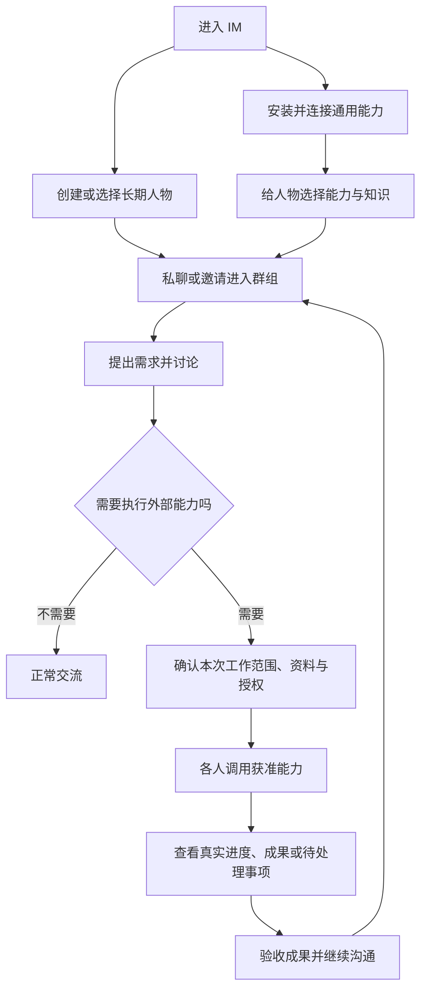

# 独立人物 IM 协作平台：产品 PRD 总入口

日期：2026-10-20。产品方向已明确；本目录形成版本化需求基线。v0.1 已进入开发，其余版本仍在计划中；尚无版本完成整版工程和用户验收。

## 1. 产品定义

这是一个通用的独立人物 IM 协作平台。用户创建长期人物，通过私聊或群组与他们沟通；给人物挂载符合接入契约的能力与知识后，他们在授权范围内直接使用这些能力完成工作。

能力可以处理写作、开发、数据分析、文档、资料检索或其他业务。小说只是一个可选能力项目。安装新能力通过发现、配置、人物授权和工作选择完成；业务类型不进入 IM 核心的枚举、数据库前置条件或固定流程。

“可以使用”要求能力服务兼容、配置有效、人物有权且依赖可用。条件不足时说明缺项并保留请求；不能把挂载一个名称或一份 Skill 视作已经具备执行工具。

## 2. 用户与目标

首版面向本地单所有者：用户组建一个长期 AI 团队，既能直接找一个人做事，也能组织多人讨论和分工。人物可跨群、跨工作复用身份；每项工作分别选能力、账号、知识与可披露范围。

核心结果：用户无需先理解任何小说流程，就能完成人物创建、沟通、挂载能力、提出需求、查看执行与接收成果。业务服务独立运行，能力故障不阻断普通 IM。

## 3. 产品规则

| 规则 | 必须保持的行为 |
| --- | --- |
| GEN-01 通用性 | 未安装小说插件、没有小说源码和数据库时，平台正常运行 |
| GEN-02 开放接入 | 新能力遵循公开契约；不用修改 IM 核心即可发现、授权、调用和呈现结果 |
| GEN-03 人物独立 | 身份、人格、模型、记忆和 Session 归人物；能力是可替换挂载项 |
| GEN-04 沟通优先 | 私聊、群聊是主界面；普通聊天无需先建业务项目或任务 |
| GEN-05 按工作组合 | 一人可做多类工作；工具、资料、账号和受众按具体上下文隔离 |
| GEN-06 真实状态 | 发言、运行、成果、失败和停止都由真实事件产生 |
| GEN-07 权限分层 | 技能说明、工具执行、资源读取、对外披露分别授权 |
| GEN-08 双向独立 | IM 和每个能力项目独立存储、构建、部署、测试、版本化 |
| GEN-09 可追踪交付 | 每个版本需求关联实施项、验收用例、缺陷和证据 |
| GEN-10 验收再发布 | 开发完成、工程验收、用户验收和发布分别记录；测试通过不冒充用户接受 |

这些是所有版本的约束。某版本暂不交付的完整功能以各版本范围为准，不能借版本切分违反已交付功能的权限和数据边界。

## 4. 用户主流程

用户可以先创建人物再安装能力，也可以先安装能力再选人物。挂载后发普通消息即可触发获准调用；只有涉及新的资源/账号/范围或需要审批的动作才追加确认，不要求每次重复配置。

## 5. 核心对象

人物、会话、群成员、消息、工作上下文、请求/承诺、能力安装、人物授权、知识绑定、外部资源、运行、调用、成果引用、审阅和个人记忆为通用对象。

IM 不内置章节、书籍、Canon、工单字段、代码分支等领域状态。业务服务自行管理；平台保存通用资源 URI、版本、操作状态、展示类型和授权映射。能力描述不带宿主执行框架的私有 Session 类型。

## 6. 版本路线

| 平台版本 | 交付目标 | PRD | 实施计划 | 验收 |
| --- | --- | --- | --- | --- |
| v0.1 | 可独立使用的人物 IM：真实私聊、群、同事沟通、只读观察 | [PRD](versions/v0.1/prd.md) | [计划](versions/v0.1/implementation-plan.md) | [用例](versions/v0.1/acceptance.md) |
| v0.2 | 通用能力、按工作授权、知识与真实成果，证明能做非小说任务 | [PRD](versions/v0.2/prd.md) | [计划](versions/v0.2/implementation-plan.md) | [用例](versions/v0.2/acceptance.md) |
| v0.3 | 多人自然分工、并行、等待、恢复、版本审阅与记忆 | [PRD](versions/v0.3/prd.md) | [计划](versions/v0.3/implementation-plan.md) | [用例](versions/v0.3/acceptance.md) |
| v1.0 | 可升级、可恢复、可审计的正式本地产品 | [PRD](versions/v1.0/prd.md) | [计划](versions/v1.0/implementation-plan.md) | [用例](versions/v1.0/acceptance.md) |

版本是交付范围，不是日期承诺。先验收当前版本，再冻结后续版本的具体实现差异。发现基础缺陷可以提前处理；不能把未完成的当前必需项挪走后仍宣称当前版本通过。

## 7. 能力的独立迭代

平台版本、能力契约版本、连接插件版本、业务服务版本分别管理。例如平台 v0.2 通过公开能力契约 1.x 使用多个独立发布的插件，不要求插件版本号等于平台版本号。

小说接入按[小说能力路线](roadmap.md#3-小说及其他能力项目)独立推进。平台验收不依赖小说服务可用；小说能力发布也不意味着平台其他用例通过。以后接入新业务能力，新增其 PRD/接入计划/契约测试与验收记录，沿用同一流程。

## 8. 文档与开发依据

| 文档 | 用途 |
| --- | --- |
| [版本路线与需求映射](roadmap.md) | 跨版本依赖、旧要求覆盖、能力独立迭代 |
| [PRD 到发布流程](delivery-process.md) | 范围、实施、变更、证据、工程/用户验收与回退 |
| [发布登记](releases.json) | 机器可读版本/需求/用例索引，状态随实际开发和证据更新 |
| [验收记录模板](acceptance-record-template.md) | 每次具体构建的结果、缺陷和用户验收记录 |
| [组合架构](../architecture/README.md) | 项目、数据与协议边界 |
| [IM UI 规格](../im/ui.md) | 页面布局和交互细节；范围以本目录版本 PRD 为准 |
| [历史交付与回归](../im/delivery.md) | 既有代码和测试证据，不是新版本完成记录 |

冲突优先级：用户最新明确要求；本目录对产品定位、版本范围与验收的决定；组合架构对工程边界的决定；IM 细节与历史计划。工程实现与 PRD 不一致时先记录差异并处理，不默默修改需求去适配已有代码。

## 9. 当前状态

已有小说引擎、局部 IM 存储测试和 OpenCode PoC。用户已允许复用参考项目代码，但禁止修改参考项目；现已复制到独立项目 `projects/persona-im` 开发，人物只读观察等已有增量一并迁入。新平台 v0.1/v0.2/v0.3/v1.0 均未完成整版验收。

平台按 v0.1 的通用 IM 闭环推进；小说接口不是平台开发前置条件。平台文档主维护位置为 `projects/persona-im/docs/product`，本目录保留同步基线与小说能力 PRD。当前副本复用 Pi SDK；原参考项目仅作只读参考，不能回写或从中启动构建、服务、自动插件打包。

## 10. 文档检查

运行 `rtk npm run docs:check`，检查版本登记、需求/计划/验收关联、ID 唯一性、依赖顺序、本地链接/锚点和 JSON。新版本或范围变更须同时更新 releases.json。该检查验证文档完整性，不执行产品验收，不会把 planned/pending 改为通过。

基线包含 4 个平台版本、1 个独立能力版本，44 条需求与 44 个用例完成关联。v0.1 为 implementing/pending，其余仍为 planned/pending；文档校验通过不改变验收状态。
