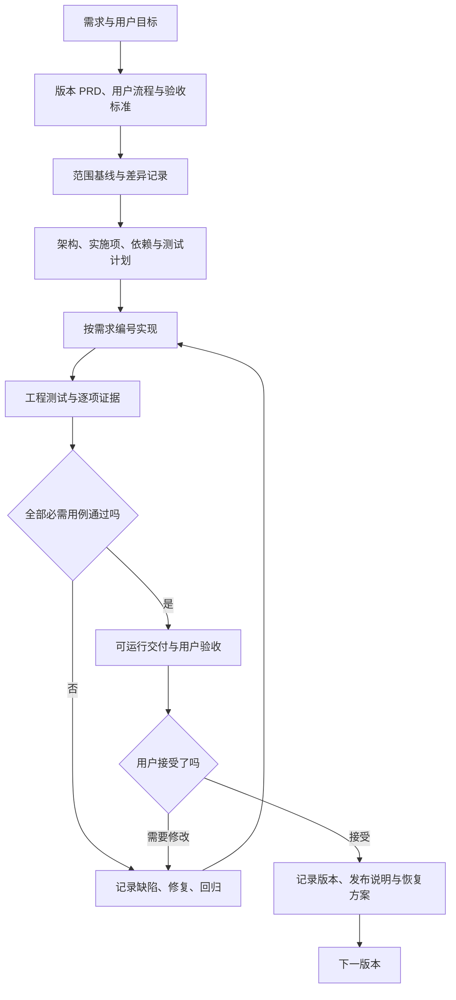

# 按 PRD 开发、验收和发布

日期：2026-10-20。适用于平台各版本和每个独立能力项目。

## 1. 一次完整交付

工程验证可以自主推进；用户验收由真实用户对具体构建给出结果，不由开发者或模型代签。没有新增范围争议时按既有需求继续实现，不把每个技术细节变成等待批准的步骤。

## 2. 每版文档必须具备

| 文件 | 必需内容 |
| --- | --- |
| prd.md | 用户目标、范围/后置项、页面流程、状态/异常、编号功能、权限与数据、非功能、发布门槛 |
| implementation-plan.md | 对应需求 ID、实现边界、顺序/依赖、接口/数据变更、验证方法、回退与交付物 |
| acceptance.md | 每项需求的前置条件、步骤、预期结果、证据；所有用例初始待测 |
| 具体构建验收记录 | 构建、环境、执行结果、缺陷、遗留项、工程结论、用户反馈和验收结论 |

跨项目能力另补连接契约、账号/资源范围、读写副作用、版本兼容和故障行为。已有接口支持度通过实测确认，不以 README 宣称替代。

## 3. 需求与实施追踪

需求使用 `P01-R01` 等稳定编号，用例使用 `P01-A01` 等编号。计划的实施项列出关联需求和验证方法；提交/PR 说明引用有关编号。未涉及代码的文档修订也保留范围和原因。

每个 must 需求至少一个验收用例。跨模块或高风险需求补负向、故障与恢复用例；断言验证行为，不复刻实现。发现缺失要求时先补 PRD/用例，再实现，不靠验收现场临时口头解释。

继承版本的已验收行为必须回归。用例可复用，结果必须对应本次构建；旧截图、夹具通过和上一版通过不能冒充当前版本证据。

## 4. 状态定义

| 状态 | 可声明的事实 |
| --- | --- |
| planned | 范围、计划、用例已列出；不代表代码完成 |
| implementing | 有关联实施项和进行中的代码 |
| engineering_verified | 本次构建所有 must 用例已通过，证据与回归完整 |
| user_accepted | 用户对具体构建完成验收，意见与结果已记录 |
| released | 已满足前述门槛，版本产物和发布记录可追溯 |

用例结果分别为 pending、passed、failed、blocked、not_applicable。blocked 不等于通过；not_applicable 须说明范围依据，不能用于跳过本版必需行为。状态登记与实际证据一致，不因文档检查通过而推进版本状态。

## 5. 工程验收门槛

每版对应 PRD 的全部 must 用例通过，关联回归通过，未解决的验收阻断缺陷为零。权限越界、数据丢失、重复外部效果、虚构成功、主流程不可完成均阻断。

兼容性、UI 和执行测试按风险覆盖。确定性夹具负责可重复的协议/错误测试；真实模型负责代表性交互与工具使用验证。模型、预算、调用数与结果分开记录；没有凭据或运行条件时标 blocked，不用 mock 冒充真实验收。

已知无关领域失败按独立构建边界记录；例如小说服务测试失败不阻断不安装小说插件的平台版本，但会阻断相应小说能力的发布。若平台运行/构建仍依赖该领域，则不能宣称已隔离。

## 6. 用户验收交付

提供具体可运行版本/地址、入口、数据准备、场景清单和[验收记录](acceptance-record-template.md)。先展示 PRD 承诺的用户结果，再展示异常与恢复；用户无需阅读工程日志才能判断成功。

用户提出的问题分为缺陷和新增需求：承诺范围内失败先修复回归；新增范围记录进入当前修订或下一版本。用户未反馈时状态停留工程验收，不代填接受日期或已通过。

## 7. 发布与后续版本

发布记录包含版本、PRD 修订、构建/commit、变更说明、验证报告、已知非阻断限制、兼容版本、备份/升级和恢复方法。打版本或产物发布与用户授权一致，不能因为形成文档就自动推送/发布。

下一版继承上一版验收基线，新增用例与本版工程设计。先处理会影响后续范围的未决问题，再扩大场景。未来所有能力项目使用同一流程，但可独立节奏发布。
